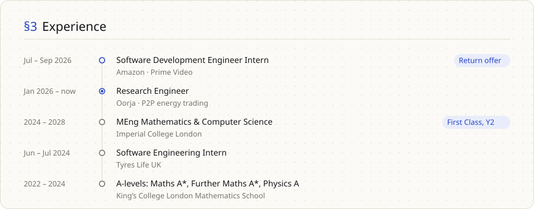
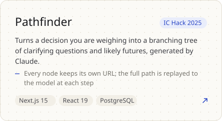
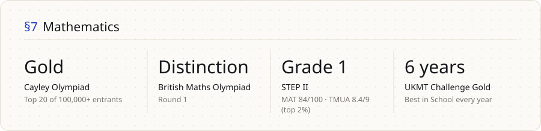
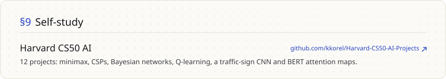
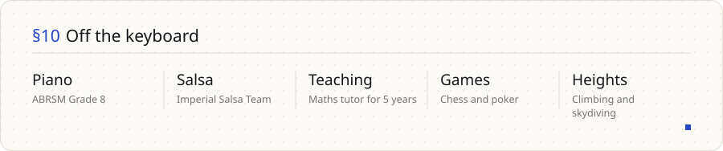

<!-- Generated by tools/build.py from profile.toml. Edit those, not this file. -->

<picture><source media="(prefers-color-scheme: dark)" srcset="https://raw.githubusercontent.com/kkorel/kkorel/main/assets/hero-dark.svg"></picture>

<a href="https://www.linkedin.com/in/kuzeykorel/">LinkedIn</a> &nbsp;·&nbsp; <a href="mailto:kuzey.korel24@imperial.ac.uk">kuzey.korel24@imperial.ac.uk</a>

<picture><source media="(prefers-color-scheme: dark)" srcset="https://raw.githubusercontent.com/kkorel/kkorel/main/assets/highlights-dark.svg"></picture>

<picture><source media="(prefers-color-scheme: dark)" srcset="https://raw.githubusercontent.com/kkorel/kkorel/main/assets/now-dark.svg"></picture>

<picture><source media="(prefers-color-scheme: dark)" srcset="https://raw.githubusercontent.com/kkorel/kkorel/main/assets/experience-dark.svg"></picture>

<picture><source media="(prefers-color-scheme: dark)" srcset="https://raw.githubusercontent.com/kkorel/kkorel/main/assets/impact-dark.svg"></picture>

<picture><source media="(prefers-color-scheme: dark)" srcset="https://raw.githubusercontent.com/kkorel/kkorel/main/assets/label-work-dark.svg"></picture>

<a href="https://github.com/kkorel/p2p-trading"><picture><source media="(prefers-color-scheme: dark)" srcset="https://raw.githubusercontent.com/kkorel/kkorel/main/assets/feature-dark.svg"></picture></a>

<picture><source media="(prefers-color-scheme: dark)" srcset="https://raw.githubusercontent.com/kkorel/kkorel/main/assets/card-fair-dark.svg"></picture> <a href="https://github.com/kkorel/CLAM-IC-HACK-2026"><picture><source media="(prefers-color-scheme: dark)" srcset="https://raw.githubusercontent.com/kkorel/kkorel/main/assets/card-clam-dark.svg"></picture></a>

<a href="https://github.com/aryan-the-jain/DRP_07"><picture><source media="(prefers-color-scheme: dark)" srcset="https://raw.githubusercontent.com/kkorel/kkorel/main/assets/card-alongside-dark.svg"></picture></a> <a href="https://github.com/kkorel/Pathfinder-IC-HACK-2025"><picture><source media="(prefers-color-scheme: dark)" srcset="https://raw.githubusercontent.com/kkorel/kkorel/main/assets/card-pathfinder-dark.svg"></picture></a>

<picture><source media="(prefers-color-scheme: dark)" srcset="https://raw.githubusercontent.com/kkorel/kkorel/main/assets/systems-dark.svg"></picture>

<picture><source media="(prefers-color-scheme: dark)" srcset="https://raw.githubusercontent.com/kkorel/kkorel/main/assets/maths-dark.svg"></picture>

<picture><source media="(prefers-color-scheme: dark)" srcset="https://raw.githubusercontent.com/kkorel/kkorel/main/assets/stack-dark.svg"></picture>

<a href="https://github.com/kkorel/Harvard-CS50-AI-Projects"><picture><source media="(prefers-color-scheme: dark)" srcset="https://raw.githubusercontent.com/kkorel/kkorel/main/assets/side-dark.svg"></picture></a>

<picture><source media="(prefers-color-scheme: dark)" srcset="https://raw.githubusercontent.com/kkorel/kkorel/main/assets/beyond-dark.svg"></picture>

